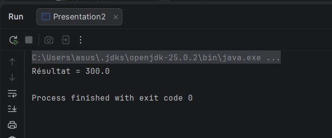

# Spring DI

Projet Maven `com.example:springdi:1.0-SNAPSHOT` utilisant Spring Context 6.1.2.

## Exécution

Utiliser un JDK 17 ou supérieur pour Maven et pour le projet Eclipse.

1. Importer le dossier dans Eclipse via **File > Import > Maven > Existing Maven Projects**.
2. Exécuter `mvn clean install` pour compiler et lancer les tests JUnit.
3. Exécuter `com.example.presentation.Presentation2` via **Run As > Java Application**.

Résultat attendu : `Résultat = 300.0`.

`MetierImpl` utilise `@Qualifier("dao2")` pour injecter `DaoImpl2` (150.0).
Pour obtenir `200.0`, remplacer ce qualifier par `@Qualifier("dao")`.
Avec plusieurs beans compatibles, Spring ne choisit pas simplement le premier :
le qualifier rend le choix explicite.

Les packages `com.example.dao` et `com.example.metier` correspondent au
`@ComponentScan` de la configuration. Le contexte Spring est fermé après utilisation.

## Résultat d'exécution

Exécution de `Presentation2` avec `@Qualifier("dao2")` :

